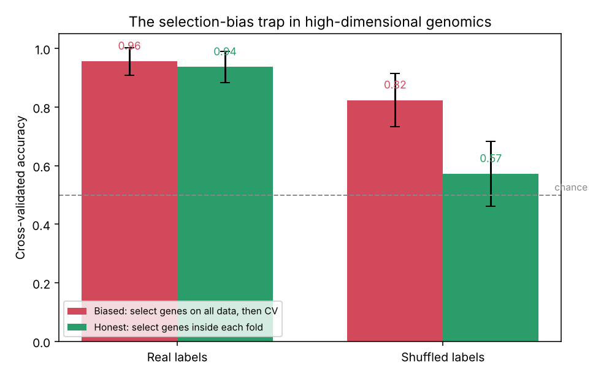
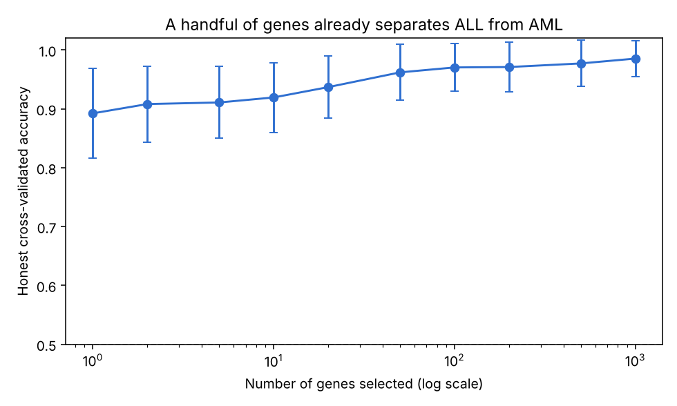
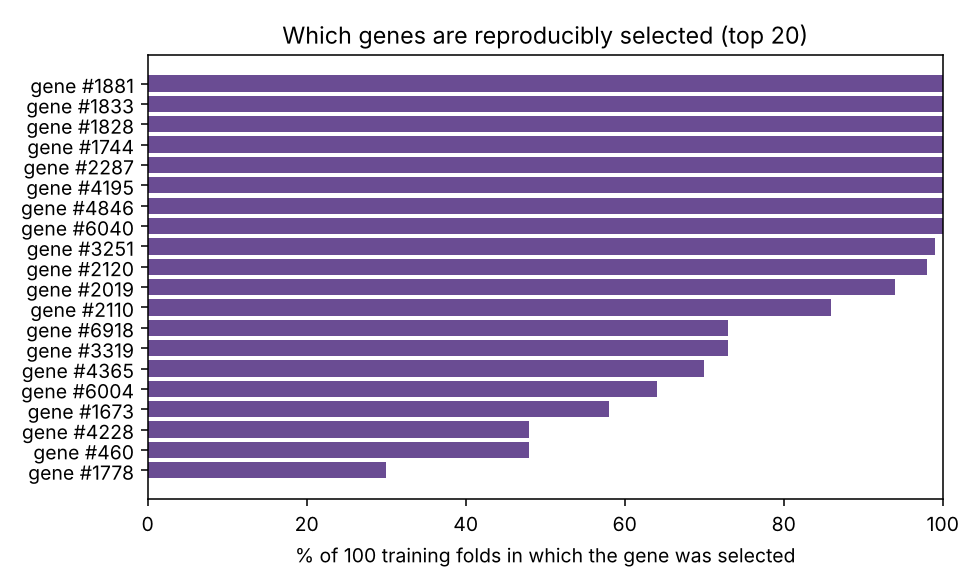

# Classifying leukemia from gene expression — and the trap that fools most attempts

Acute lymphoblastic leukemia (ALL) and acute myeloid leukemia (AML) are two cancers that need different
treatment, and a landmark 1999 study (Golub *et al.*, *Science*) showed they can be told apart from gene
expression alone. This project reproduces that result on the same data — **but its real subject is the
statistical trap that makes most high-dimensional genomic classifiers report accuracies that don't hold
up**, and how to get the honest number instead.

The dataset has **72 patients and 7,129 genes**. When there are a hundred times more features than
samples (*p ≫ n*), it is extraordinarily easy to produce a flawless-looking cross-validation score that
is pure leakage. This project shows exactly how that happens and measures the difference.

## The key result

The same pipeline — rank genes by ALL-vs-AML difference, keep the top 20, classify with logistic
regression — is run two ways, and on real labels **and** on randomly shuffled labels. On shuffled labels
no gene can truly predict anything, so an honest method must score near 50%.

| Protocol | Real labels | **Shuffled labels** |
|---|---|---|
| **Biased** — pick genes on all data, *then* cross-validate | 0.96 | **0.82** ← inflated, pure leakage |
| **Honest** — pick genes *inside* each training fold | 0.94 | **0.57** ← correctly near chance |



The biased protocol "achieves" 82% accuracy on **random** labels. That accuracy is entirely an artefact
of letting the gene-selection step see the test samples. The honest protocol, which selects genes using
only each fold's training data, correctly falls to chance on random labels — which is why its number on
real data (0.94) is the one to trust. This is the effect described by Ambroise & McLachlan (PNAS, 2002),
reproduced here from scratch.

## How separable is the leukemia, really?

With the honest protocol, ALL and AML are genuinely easy to separate — a single gene already reaches
~89%, twenty genes ~94%, and the accuracy keeps climbing toward ~98% as more genes are added.



## A stable signature

A gene signature is only useful if the same genes keep getting chosen. Counting how often each gene is
selected across all 100 training folds, eight genes are picked in **every single fold** — a reproducible
core signature, as opposed to genes that look important once by chance.



`scikit-feature`'s matrix carries no gene symbols, so genes appear by column index; mapping the stable
indices to names would use the dataset's Affymetrix Hu6800 annotation. The point demonstrated here is the
*reproducibility* of the selection, which is the property a trustworthy signature must have.

## How it works

| Step | Choice | Why |
|---|---|---|
| Gene ranking | ANOVA F-test (`f_classif`) | Fast univariate score of between-class difference |
| Classifier | Logistic regression (L2) | Simple, calibrated linear model suited to wide data |
| Evaluation | Repeated stratified 5-fold CV (×20) | Stable estimates on only 72 samples |
| The honest bit | Selection inside a `Pipeline` | Guarantees genes are chosen without ever seeing the held-out fold |

## Data

The **`ALLAML`** benchmark (Golub ALL/AML leukemia) as distributed with
[`scikit-feature`](https://github.com/jundongl/scikit-feature): 72 patients (47 ALL, 25 AML) × 7,129
genes. A copy is bundled in `data/allaml.npz`; the notebook loads that if present and otherwise clones
`scikit-feature` and reads `ALLAML.mat` directly, so it runs anywhere.

## How to run

Open `notebooks/leukemia_classifier.ipynb` in Google Colab or Jupyter and run all cells (about a minute
— it is CPU-only). To run locally:

```bash
pip install -r requirements.txt
```

## Repository layout

```
notebooks/   the analysis notebook
data/        bundled ALLAML expression matrix (allaml.npz)
results/     metrics, accuracy curve, stable-gene list (results.json)
figures/     the three figures above
```

## What this project demonstrates

- The *p ≫ n* problem that defines machine learning on genomic data.
- **Selection bias / data leakage**, shown with a shuffled-label control rather than merely asserted.
- Building a leakage-free evaluation with a scikit-learn `Pipeline` and repeated stratified CV.
- Reasoning about how many features are actually needed, and the stability of a selected signature.
- Reproducing a foundational computational-biology result and reporting the honest accuracy.

## Limitations

- 72 patients is small; even with repeated CV the estimates carry a few points of uncertainty, and a
  truly independent cohort would be the stronger test.
- The expression matrix is pre-standardised and unannotated, so this project stops at gene indices rather
  than named biomarkers.
- Univariate selection ignores gene–gene interactions; multivariate or embedded selection could find a
  smaller or more biologically coherent signature.

## References

- Golub T.R. *et al.* Molecular classification of cancer: class discovery and class prediction by gene
  expression monitoring. *Science* 286, 531–537 (1999).
- Ambroise C. & McLachlan G.J. Selection bias in gene extraction on the basis of microarray
  gene-expression data. *PNAS* 99, 6562–6566 (2002).
- Li J. *et al.* Feature selection: a data perspective (`scikit-feature`). *ACM Computing Surveys* (2017).

## Author

**Hafsa Fathima Khajamainudeen**
M.Sc. Bioinformatics & Data Science, Sathyabama Institute of Science and Technology
[Google Scholar](https://scholar.google.com/citations?hl=en&user=Iz5aXRUAAAAJ) · hafsafathima2004@gmail.com

*Code developed with the assistance of an AI coding tool; the analysis design, interpretation and conclusions are the author's own.*
